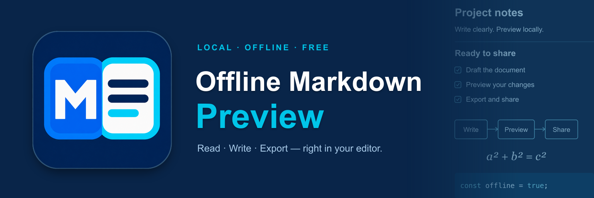
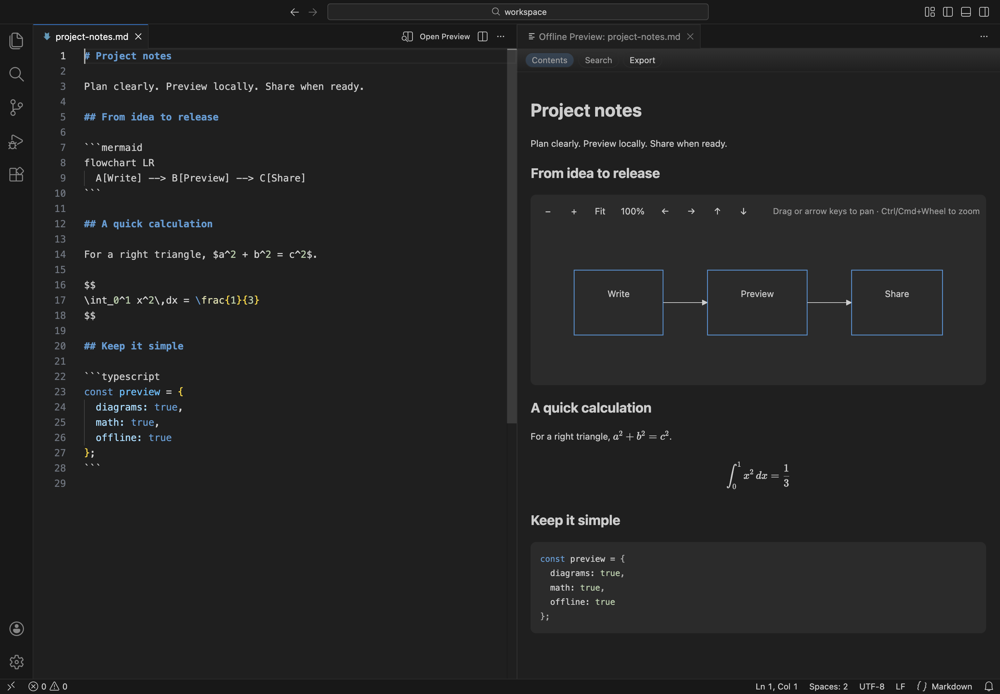

# Offline Markdown Preview



**Your Markdown, diagrams, and math — rendered locally in your editor.**

Read while you write, find your place in long documents, and export the finished preview to HTML or PDF. Mermaid, KaTeX, and syntax highlighting are bundled with the extension. No rendering service, document upload, or telemetry.

**[Install from Visual Studio Marketplace](https://marketplace.visualstudio.com/items?itemName=bowlerr.offline-markdown-preview)** · **[Install from Open VSX](https://open-vsx.org/extension/bowlerr/offline-markdown-preview)**

[](https://marketplace.visualstudio.com/items?itemName=bowlerr.offline-markdown-preview)
[](LICENSE)

[Quick start](#quick-start) · [Supported editors](#supported-editors) · [Features](#made-for-reading-and-writing) · [Demos](#see-it-in-action) · [Configuration](#make-it-yours) · [Privacy](#offline-by-default) · [Help](#need-a-hand)

## Quick start

Use a compatible desktop editor from the [supported editors](#supported-editors) below. PDF export also needs a local installation of **Chrome, Edge, or Chromium**.

1. Install **Offline Markdown Preview** using your editor's registry:
   - **VS Code:** use the [Visual Studio Marketplace listing](https://marketplace.visualstudio.com/items?itemName=bowlerr.offline-markdown-preview), or run the command below in a terminal with VS Code's `code` command.
   - **Open VSX-compatible editors**, such as [VSCodium](https://github.com/VSCodium/vscodium/blob/master/docs/extensions.md#how-to-use-the-open-vsx-registry): search the editor's Extensions view for **Offline Markdown Preview** by **bowlerr**, or visit the [Open VSX listing](https://open-vsx.org/extension/bowlerr/offline-markdown-preview).

   ```sh
   # VS Code CLI
   code --install-extension bowlerr.offline-markdown-preview
   ```

2. Open a Markdown file. The preview opens automatically when a Markdown editor becomes active.
3. Start writing. The preview updates as you type, and editor and preview scrolling stay in sync.
4. Use **Contents** to jump between headings, **Search** to find text, or **Export** to save HTML or PDF.

Prefer to open the preview yourself? Set `offlineMarkdownViewer.preview.autoOpen` to `false`, then run **Offline Markdown Preview: Open Preview** from the Command Palette. **Open Preview in Current Group** is available too.

## Supported editors

The extension targets desktop editors that support the **VS Code 1.90 extension API** or newer.

| Editor       | Installation                                                                                                                                                                                                                                                          |
| ------------ | --------------------------------------------------------------------------------------------------------------------------------------------------------------------------------------------------------------------------------------------------------------------- |
| **VS Code**  | Install from the [Visual Studio Marketplace](https://marketplace.visualstudio.com/items?itemName=bowlerr.offline-markdown-preview).                                                                                                                                   |
| **VSCodium** | Search its [Extensions view](https://github.com/VSCodium/vscodium/blob/master/docs/extensions.md#how-to-use-the-open-vsx-registry), which uses Open VSX by default, or visit the [Open VSX listing](https://open-vsx.org/extension/bowlerr/offline-markdown-preview). |
| **Cursor**   | Search its [Extensions panel](https://cursor.com/help/customization/extensions), which uses Open VSX, for **Offline Markdown Preview** by **bowlerr**.                                                                                                                |

Automated application tests cover **VS Code 1.90 and current stable**. VSCodium and Cursor provide compatible extension installation paths; their runtime behavior with this extension has not been independently verified.

**Editor missing or extension not working?** [Report an editor compatibility issue](https://github.com/Bowlerr/offline-markdown-preview/issues/new?title=Editor%20compatibility%3A%20%5Beditor%20name%5D&body=%23%23%20Editor%0A-%20Name%3A%0A-%20Version%3A%0A%0A%23%23%20Extension%20version%0A%0A%23%23%20Operating%20system%20and%20version%0A%0A%23%23%20Expected%20behavior%0A%0A%23%23%20Actual%20behavior%0A%0A%23%23%20Minimal%20reproduction%0A1.%0A2.%0A3.%0A%0AInclude%20a%20small%20Markdown%20example%20if%20relevant.%0A).

## Made for reading and writing

| Workflow              | What you get                                                                                               |
| --------------------- | ---------------------------------------------------------------------------------------------------------- |
| **Write and review**  | Live updates, scroll sync, and a preview that keeps your reading position during edits.                    |
| **Explain an idea**   | Mermaid diagrams, KaTeX math, and highlighted code blocks, rendered with bundled libraries.                |
| **Find your place**   | A contents list, heading quick pick, copyable heading links, and search across code and inline formatting. |
| **Explore diagrams**  | Pan and zoom with the mouse, keyboard, or diagram toolbar.                                                 |
| **Share your work**   | HTML and PDF exports from the completed preview, preserving its background and text colors.                |
| **Choose your style** | Installed GitHub preview styling, your own CSS, and optional frontmatter display.                          |

## See it in action



Choose a demo to open the animation.

| Demo                             | Take a look                                                                    |
| -------------------------------- | ------------------------------------------------------------------------------ |
| **Live preview and scroll sync** | [Watch edits and scrolling stay together →](images/scroll.gif)                 |
| **Mermaid and math**             | [Watch diagrams and equations render →](images/mermaid.gif)                    |
| **Contents navigation**          | [Watch heading navigation →](images/content-scroll.gif)                        |
| **Remote image download**        | [Watch an explicit image download and local cache →](images/remote-images.gif) |

## Navigate without losing your place

Search includes fenced code and phrases split across inline formatting. Broad queries show the first **1,000 matches** and indicate when that limit is reached; refine the query to narrow the results.

With focus inside the preview:

| Shortcut                                   | Action                                     |
| ------------------------------------------ | ------------------------------------------ |
| `Ctrl+F` / `Cmd+F`                         | Open or focus search                       |
| `Enter` / `Shift+Enter` in search          | Next / previous match                      |
| `Escape`                                   | Hide search and return focus to its toggle |
| Arrow keys on a focused diagram            | Pan the diagram                            |
| `Enter` / `Space` on a focused local image | Open the image                             |

The contents list keeps keyboard focus when you select a heading. Diagram controls also support zoom, fit, and actual size; see the [full shortcut reference](docs/CONFIGURATION.md#keyboard-and-mouse-controls).

## Export the finished preview

Use the preview's **Export** button or run **Offline Markdown Preview: Export HTML** or **Offline Markdown Preview: Export PDF**.

- **HTML:** saves the rendered document and styles. Local images remain file references by default. To include their contents in the HTML file, enable `offlineMarkdownViewer.export.embedImages` and review the confirmation before exporting.
- **PDF:** uses a local Chrome, Edge, or Chromium installation. It waits for images and fonts; layout can vary slightly by browser and platform.
- **Consistent output:** export captures a completed preview. A document change during capture or a preview-rendering timeout cancels the export with a message so you can retry.

Exports block remote images by default and prevent document scripts from running. Enabling remote images also enables them during export. See [export settings and limits](docs/CONFIGURATION.md#export).

## Make it yours

Open your editor's Settings and search for **Offline Markdown Preview**, or edit your settings JSON. For example:

```json
{
  "offlineMarkdownViewer.preview.autoOpen": false,
  "offlineMarkdownViewer.preview.showFrontmatter": true,
  "offlineMarkdownViewer.preview.customCssPath": ".vscode/markdown-preview.css"
}
```

Put the CSS path in **workspace or folder settings** and keep the file inside that workspace. For a stylesheet shared across projects, use `offlineMarkdownViewer.preview.globalCustomCssPath` in user settings instead.

Run **Offline Markdown Preview: Set Custom CSS** to choose a stylesheet interactively or reuse the installed **Markdown Preview Github Styling** extension. Styles apply in this order: base styles → installed GitHub styles → global CSS → workspace CSS, following the normal CSS cascade.

**[All settings and commands](docs/CONFIGURATION.md)** · **[Custom CSS setup and examples](docs/custom-css/README.md)**

## Offline by default

Rendering uses local, bundled libraries. The extension does not upload your Markdown or collect telemetry. Preview and export do not require a network connection with the default settings.

- **Remote images start blocked.** Choose **Download Image** to fetch a specific URL and cache the image locally, or explicitly enable `offlineMarkdownViewer.preview.allowRemoteImages` to load remote images directly. These actions make network requests.
- **HTML sanitization is enabled.** A Content Security Policy restricts what the preview can load and run. Disabling sanitization is unsafe for untrusted content.
- **External links ask first.** Opening a link uses your browser after confirmation by default.
- **Local image access stays within allowed roots.** Image actions and embedding are limited to the document's workspace, its containing directory outside a workspace, or the extension's image cache. Escaping symlinks are rejected.
- **Image downloads have limits.** Local images and explicit downloads use the configured size limit, which defaults to 24 MB. Downloads also have a 30-second timeout.

Use **Show Remote Image Cache Usage** or **Clear Remote Image Cache** from the Command Palette to manage downloaded files. The [cache reference](docs/CONFIGURATION.md#remote-image-cache) explains storage locations and session behavior.

## Need a hand?

| If you see…                           | Try this                                                                                                               |
| ------------------------------------- | ---------------------------------------------------------------------------------------------------------------------- |
| A diagram or equation shown as source | Check its syntax and the `enableMermaid` / `enableMath` settings.                                                      |
| A missing image                       | Check the path and size limit. For a remote image, use **Download Image** or explicitly allow remote images.           |
| CSS that does not apply               | Check the file's location, `.css` extension, and setting scope. Follow the [styling guide](docs/custom-css/README.md). |
| An export cancelled before saving     | Wait for the preview to finish rendering, then retry.                                                                  |
| A PDF export failure                  | Check that a supported browser is installed, then open **View → Output → Offline Markdown Preview** for diagnostics.   |

See [troubleshooting and known limits](docs/CONFIGURATION.md#troubleshooting-and-known-limits) for more detail. To report a problem, [open an issue](https://github.com/Bowlerr/offline-markdown-preview/issues) with your extension version, editor name and version, operating system, and a small example that reproduces it.

## Project

Free and open source under the [MIT License](LICENSE).

[Changelog](CHANGELOG.md) · [Contributing](CONTRIBUTING.md) · [Credits and bundled libraries](CREDITS.md) · [Source on GitHub](https://github.com/Bowlerr/offline-markdown-preview)
