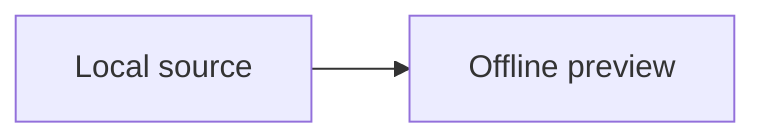

# Release Journey

This preview works **entirely offline** with local assets.

## Search and navigation

A distinctive cross **format** phrase appears here.

The same cross format phrase appears here too.

```typescript
const searchableCode = 'cross format';
```

## Mathematics

Inline $a^2+b^2=c^2$ and display mathematics:

$$
\int_0^1 x^2 dx = \frac{1}{3}
$$

## Diagrams



## Images and links


[Open linked document](./linked-doc.md)

## Unsafe authored HTML


<script>document.body.dataset.unsafe = 'executed';</script>

<a href="javascript:document.body.dataset.unsafe='executed'">Unsafe link</a>

## Final section

This is the final section.
